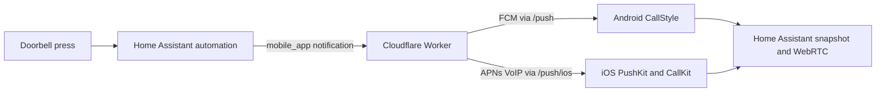

# Doorbell Companion

Fast incoming doorbell calls for **Home Assistant** on **Android and iOS**. Doorbell Companion works with Home Assistant doorbell cameras, including **UniFi Protect**, and starts connecting to your camera while the phone rings.

| Platform | Incoming call |
| --- | --- |
| **Android** | A full-screen lock-screen call shows a snapshot and switches to live video as soon as the first frame arrives. |
| **iOS** | The native CallKit screen rings on the lock screen. Answer to open Doorbell Companion with a snapshot, live video, and audio. |

## Features

- **Automatic setup.** Discover Home Assistant over Wi-Fi, sign in through your browser, and let Doorbell Companion find your doorbells, register your phone, and create the ring automation.
- **Fast camera preview.** Fetch a snapshot and start WebRTC signaling as soon as the push arrives. The snapshot stays visible until the live feed renders.
- **Local and remote connections.** Doorbell Companion tries your local and external Home Assistant WebSockets in parallel when both addresses are available.
- **Live audio and talkback.** Hear the visitor when you answer. The microphone and mute control are available when Home Assistant and the camera support two-way audio over WebRTC.
- **Multiple doorbells.** Turn individual doorbells on or off in Settings. Doorbell Companion keeps the Home Assistant automation in sync.
- **Stateless push relay.** The Cloudflare Worker forwards Home Assistant notifications to Firebase Cloud Messaging for Android and Apple Push Notification service (APNs) for iOS.

## How it works



## Requirements

- **Home Assistant** with WebRTC (go2rtc) and a doorbell that exposes a `camera.*` entity and a doorbell `binary_sensor.*` or `event.*` entity. For calls away from home, your phone needs access to your external Home Assistant URL.
- **Android 8.1+** (API 27+) with Google Play Services.
- **iOS 15+** on an iPhone. The iOS build needs Apple signing with Push Notifications enabled and a relay configured for APNs VoIP.
- **Flutter** with Dart `^3.13.0` to build from source. Use the Android SDK and Java 17 for Android, or Xcode on macOS for iOS.

## Build and install

### Android

```sh
cd app
flutter pub get
flutter build apk --release --split-per-abi
adb install -r build/app/outputs/flutter-apk/app-arm64-v8a-release.apk
```

### iOS

1. Run `flutter pub get` from `app/` and open `app/ios/Runner.xcworkspace` in Xcode.
2. Select your Apple Developer team for **Runner** and enable Push Notifications for the bundle ID, `nl.niek.doorbellcompanion` by default.
3. Configure the relay for the APNs environment of your build. Debug uses sandbox and Profile and Release use production by default. Match `DOORBELL_COMPANION_APNS_ENVIRONMENT` to your provisioning profile. [iOS relay setup](worker/README.md#ios-voip-pushes)
4. Connect your iPhone and run `flutter run -d <iphone-device-id>` from `app/`.

## Connect Home Assistant

If you already use a build with an earlier app ID, disconnect it from Home Assistant before setting up the new installation to avoid duplicate rings.

1. Open **Doorbell Companion** on Wi-Fi and select your discovered instance, or enter its URL manually.
2. Sign in through your browser. Doorbell Companion discovers your doorbells and creates the Home Assistant automation.
3. On Android, grant **Notifications** and **Full-screen lockscreen calls** when prompted. On either platform, grant **Microphone** if you want to use talkback with a compatible camera.
4. Tap **Test call** to check video and audio. To check the full push path, tap **Test push** and lock your phone within 3 seconds.

## Self-host the push relay

The app defaults to the hosted relay. To run your own Cloudflare Worker, configure the push credentials for the platforms you use. [Worker setup](worker/README.md)

- **Android.** Configure Firebase Cloud Messaging and set `PUSH_RELAY_URL` to your Worker's `/push` endpoint. [Android configuration](app/android/app/src/main/kotlin/nl/niek/doorbellcompanion/HomeAssistantAuth.kt)
- **iOS.** Configure APNs and set `DoorbellCompanionRelayURL` to your Worker's HTTPS origin. The Worker serves `/ios` for Home Assistant sign-in and `/push/ios` for VoIP notifications. [iOS configuration](app/ios/Runner/Info.plist)

## Performance and diagnostics

- **UniFi Protect.** Enable the medium-resolution camera entity in Home Assistant and tap **Refresh** in Doorbell Companion Settings. Doorbell Companion prefers that channel when available, which can reduce startup time on cellular connections.
- **Android cold starts.** Doorbell Companion caches ICE configuration and uses a long-lived Home Assistant token to reduce round trips when a call arrives.
- **Android timings.** Run `adb logcat -s DoorbellTiming:I DoorbellCompanion:I` to see elapsed times from push receipt through signaling, the snapshot, and the first live frame.
- **iOS timings.** Filter the Xcode device console for `Doorbell Companion` to see incoming call and playback events.

## Repository structure

- [`app/`](app/) contains the shared Flutter UI, the Android Kotlin implementation, and the iOS Swift implementation.
- [`worker/`](worker/) contains the Cloudflare relay for FCM and APNs.

## License

[MIT](LICENSE)
