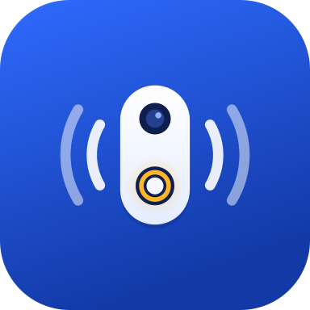
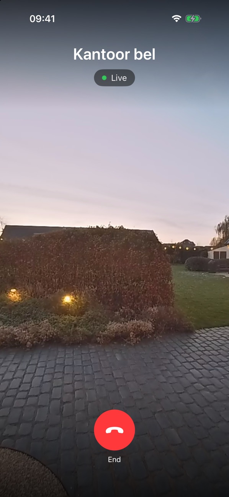
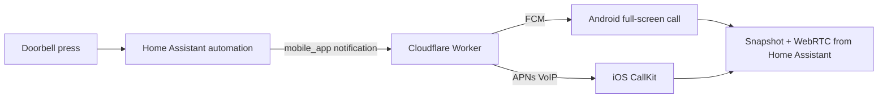

<p align="center"></p>

<h1 align="center">Doorbell Companion</h1>

<p align="center">
  From doorbell press to talking with your visitor in under a second.<br>
  Live video calls for Home Assistant doorbells on Android and iOS.
</p>

<p align="center">
  <a href="https://play.google.com/apps/testing/nl.niek.doorbellcompanion"></a>
  <a href="https://testflight.apple.com/join/tQCjCUU6"></a>
</p>

<p align="center">
  
</p>

Doorbell manufacturer apps are painfully slow. A quiet notification arrives late, unlocking your phone and opening the app takes 10 seconds of loading spinners, and by the time the camera connects your visitor is already walking away.

Doorbell Companion rings your phone like a real call instead: a full-screen call on Android, or the native CallKit screen on iOS. It wakes your phone immediately and starts connecting the camera while it's still ringing, so live video and audio are already ready the moment you answer.

## Features

- **Rings like a real call.** High-priority FCM and APNs VoIP pushes break through immediately, ringing your phone instead of sending a notification you miss.
- **Instant video.** Shows a snapshot right away, starts WebRTC while ringing so live video takes over at the first frame, and tries your local and remote addresses in parallel.
- **Two-way audio.** Hear visitors immediately, and talk back when your camera supports two-way audio.
- **One-tap setup.** Finds Home Assistant on your Wi-Fi, signs in through the browser, and creates the shared ring automation for you.
- **Multi-doorbell & multi-phone.** Turn each doorbell on or off per phone in Settings.

## Doorbell compatibility

Based on Home Assistant Core [2026.11.3](https://github.com/home-assistant/core/tree/2026.11.3/homeassistant/components) and [2026.12.0b2](https://github.com/home-assistant/core/tree/2026.12.0b2/homeassistant/components) (not every model has been hardware-tested):

| Home Assistant integration | Audio | Setup and notes |
| --- | --- | --- |
| [Reolink](https://www.home-assistant.io/integrations/reolink/) | Two-way (supported models) | Keep the default RTSP protocol. |
| [UniFi Protect](https://www.home-assistant.io/integrations/unifiprotect/) | Listen only | Set up with a local user (not API key only), or rings won't be detected. Talkback tracked in go2rtc [#2712](https://github.com/AlexxIT/go2rtc/pull/2712) and [#2340](https://github.com/AlexxIT/go2rtc/pull/2340). |
| [Ring](https://www.home-assistant.io/integrations/ring/) | Listen only / Two-way (beta) | Keep **Last recording** disabled. Two-way audio added in [Core #190763](https://github.com/home-assistant/core/pull/190763). |
| [Google Nest](https://www.home-assistant.io/integrations/nest/) | Listen only | Newer WebRTC models (such as the battery doorbell) are untested and show a placeholder until video starts ([snapshots proposed](https://github.com/home-assistant/core/pull/194637)). |
| [Axis I8116-E](https://www.home-assistant.io/integrations/axis/) | Listen only | Enable audio in the stream profile. |
| [DoorBird](https://www.home-assistant.io/integrations/doorbird/) | None | Ring and live video; DoorBird's video stream has no audio. |
| [HomeKit Device](https://www.home-assistant.io/integrations/homekit_controller/) | None | Ring and snapshots. Live video and talkback proposed in [Core #194068](https://github.com/home-assistant/core/pull/194068). |

> [!NOTE]
> For two-way audio, enable **Settings → System → Labs → Two-way audio** in Home Assistant.

## Requirements

- **Phone:** Android 8.1+ with Google Play Services, or iOS 15+.
- **Home Assistant:** A supported doorbell with a WebRTC-compatible camera stream.
- **Away from home:** An external Home Assistant URL configured for remote calls.

<details>
<summary>Custom or unlisted doorbells: how auto-discovery matches entities</summary>

Doorbell press detection needs a `camera.*` entity and a press `binary_sensor.*` or `event.*` entity on the same Home Assistant device. The press entity must either:

- have the `doorbell` device class or translation key,
- have an entity ID ending in `_doorbell`, or
- be a Reolink **Visitor** sensor.

</details>

## Setup

1. Open the app on your home Wi-Fi and select your Home Assistant instance, or enter its URL.
2. Sign in. The app discovers your doorbells and sets up one shared Home Assistant automation. Each phone can independently choose which doorbells call it.
3. Allow **Notifications** (and **Full-screen calls** on Android). Allow **Microphone** access for talkback.
4. Under a doorbell, tap **View** to check the camera, then tap **Test ring** and lock your phone during the 3-second countdown to test an incoming call.

> [!TIP]
> **UniFi Protect:** Enable the medium-resolution camera entity for faster video startup on cellular, then tap refresh in the app's **Settings** to rescan doorbells and update the shared automation.

### Disconnecting and uninstalling

Before uninstalling, use **Settings → Home Assistant → Disconnect** and wait for it to finish. This removes the phone's doorbell subscriptions and Mobile App registration and revokes its Home Assistant session, while leaving the shared automation active for remaining phones.

## How it works



## Build from source

Requires Flutter (Dart `^3.13`).

### Android

```sh
cd app
flutter build apk --release --split-per-abi
adb install -r build/app/outputs/flutter-apk/app-arm64-v8a-release.apk
```

### iOS

1. Open `app/ios/Runner.xcworkspace` in Xcode, pick your team, and enable **Push Notifications** for `nl.niek.doorbellcompanion`.
2. Set `DOORBELL_COMPANION_APNS_ENVIRONMENT` to match your provisioning profile (`development` for Debug/sandbox, `production` for Release).
3. Run `flutter run` from `app/`.

For APNs VoIP relay configuration, see [Relay setup for iOS](worker/README.md#ios-voip-pushes).

## Self-hosting the relay

The app uses a hosted Cloudflare Worker relay by default. To run your own, follow the [Worker setup](worker/README.md) and update the relay base URL in:

- **Android:** `RELAY_BASE_URL` in [HomeAssistantAuth.kt](app/android/app/src/main/kotlin/nl/niek/doorbellcompanion/HomeAssistantAuth.kt)
- **iOS:** `DoorbellCompanionRelayURL` in [Info.plist](app/ios/Runner/Info.plist)

## Debugging timings

- **Android:** `adb logcat -s DoorbellTiming:I DoorbellCompanion:I`
- **iOS:** Filter the Xcode console for `Doorbell Companion`.

## License

[MIT](LICENSE)
