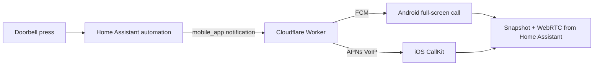

<p align="center"></p>

<h1 align="center">Doorbell Companion</h1>

<p align="center">From doorbell press to talking with your visitor in under a second.<br>Live video calls for Home Assistant doorbells on Android and iOS.</p>

<p align="center">
  
</p>

Most doorbell notifications arrive late and open a slow camera view. Doorbell Companion rings your phone like a real call instead: a full-screen call on Android, the native CallKit screen on iOS. The camera connects while it's still ringing, so it's ready when you answer.

## Test builds

<p>
  <a href="https://play.google.com/apps/testing/nl.niek.doorbellcompanion"></a>
  <a href="https://testflight.apple.com/join/tQCjCUU6"></a>
</p>

Google Play enrollment requires a published open-test build. TestFlight enrollment requires a build approved for external testing.

## Features

- **Built for speed.** High-priority FCM and VoIP pushes ring the phone straight away. A snapshot shows instantly, WebRTC takes over at the first frame, and local and remote addresses are tried in parallel.
- **Talkback.** Hear visitors, and talk back when the camera supports two-way audio.
- **One-tap setup.** Finds Home Assistant on your Wi-Fi, signs in through the browser, and creates the ring automation for you.
- **Multiple doorbells.** Turn each one on or off in Settings.

## Doorbell compatibility

Expected support from Home Assistant Core source for [2026.11.3](https://github.com/home-assistant/core/tree/2026.11.3/homeassistant/components) and [2026.12.0b2](https://github.com/home-assistant/core/tree/2026.12.0b2/homeassistant/components).

| Home Assistant integration | Audio | Setup and limits |
| --- | --- | --- |
| [Reolink](https://www.home-assistant.io/integrations/reolink/) | Two-way on supported models | Keep the default RTSP protocol. |
| [UniFi Protect](https://www.home-assistant.io/integrations/unifiprotect/) | Listen only. Talkback in open go2rtc PRs [#2712](https://github.com/AlexxIT/go2rtc/pull/2712) and [#2340](https://github.com/AlexxIT/go2rtc/pull/2340). | Set up the integration with a local user, not API key only, or rings won't be detected. |
| [Ring](https://www.home-assistant.io/integrations/ring/) | Listen only on stable. [Two-way in beta](https://github.com/home-assistant/core/pull/190763). | Keep **Last recording** disabled. |
| [Google Nest](https://www.home-assistant.io/integrations/nest/) | Listen only | Newer WebRTC models, such as the battery doorbell, are untested and show a placeholder until video starts ([snapshots proposed](https://github.com/home-assistant/core/pull/194637)). |
| [Axis I8116-E](https://www.home-assistant.io/integrations/axis/) | Listen only | Enable audio in the stream profile. |
| [DoorBird](https://www.home-assistant.io/integrations/doorbird/) | None | Ring and live video. DoorBird's video stream has no audio. |
| [HomeKit Device](https://www.home-assistant.io/integrations/homekit_controller/) | None | Ring and snapshots. Live video and talkback proposed in [Core #194068](https://github.com/home-assistant/core/pull/194068). |

For two-way audio, enable **Settings → System → Labs → Two-way audio** in Home Assistant.

## How it works



## Requirements

- Doorbell press detection needs a `camera.*` and a press `binary_sensor.*` or `event.*` on the same Home Assistant device. The press entity needs the `doorbell` device class or translation key, an entity ID ending in `_doorbell`, or to be a Reolink **Visitor** sensor.
- Live video and audio need a compatible WebRTC stream. Calls away from home need your external Home Assistant URL.
- Android 8.1+ with Google Play Services, or iOS 15+.
- Flutter (Dart `^3.13`) to build.

## Build

**Android**

```sh
cd app
flutter build apk --release --split-per-abi
adb install -r build/app/outputs/flutter-apk/app-arm64-v8a-release.apk
```

**iOS.** Open `app/ios/Runner.xcworkspace`, pick your team, and enable Push Notifications for `nl.niek.doorbellcompanion`. Set `DOORBELL_COMPANION_APNS_ENVIRONMENT` to match your provisioning profile (Debug uses sandbox, Release uses production), then run `flutter run` from `app/`. [Relay setup for iOS](worker/README.md#ios-voip-pushes)

## Setup

1. Open the app on your home Wi-Fi and pick your Home Assistant, or enter its URL.
2. Sign in. The app finds your doorbells and sets up one shared Home Assistant automation. Each phone can choose which doorbells call it.
3. Allow notifications, and on Android full-screen calls. Allow the microphone for talkback.
4. Under a doorbell, tap **View** to check the camera, then **Test ring** and lock your phone within 3 seconds.

Before uninstalling, use **Settings → Home Assistant → Disconnect** and wait for it to finish. This removes the phone’s doorbell subscriptions and Mobile App registration and revokes its Home Assistant session. The shared automation serves the remaining phones.

## Self-hosting the relay

The app uses a hosted relay by default. To run your own, follow the [Worker setup](worker/README.md) and point the app at it with `PUSH_RELAY_URL` in [HomeAssistantAuth.kt](app/android/app/src/main/kotlin/nl/niek/doorbellcompanion/HomeAssistantAuth.kt) (Android) and `DoorbellCompanionRelayURL` in [Info.plist](app/ios/Runner/Info.plist) (iOS).

## Tips

- **UniFi Protect:** enable the medium-resolution camera entity for faster video startup on cellular. Tap refresh in the app’s Settings to rescan doorbells and update the shared automation.
- **Timings:** run `adb logcat -s DoorbellTiming:I DoorbellCompanion:I` on Android, or filter the Xcode console for `Doorbell Companion` on iOS.

## License

[MIT](LICENSE)
