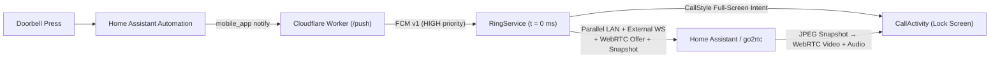

# Protect Fast

Instant, full-screen incoming doorbell calls for **Home Assistant** (built for **UniFi Protect**, compatible with any HA doorbell camera) on Android — with pre-warmed WebRTC live video, an instant snapshot preview, and zero-config setup.

Standard doorbell notifications require unlocking your phone, tapping a banner, waiting for an app to boot, and waiting for a video stream to connect. **Protect Fast** wakes your locked screen directly into an incoming-call screen and begins negotiating WebRTC **at `t = 0 ms`** the moment the push arrives.

---

## Features

- **Lock-screen incoming call UI:** Uses Android `CallStyle` notifications + full-screen intent to wake the screen straight into an edge-to-edge video view (tap the video to toggle Fill / Fit).
- **Pre-warmed WebRTC at `t = 0 ms`:** On push receipt (`RingService`), Protect Fast immediately starts WebRTC SDP offer generation, WebSocket signaling, and camera snapshot loading *before* `CallActivity` finishes opening.
- **LAN + external WebSocket racing:** Discovers and stores both your Home Assistant `external_url` (for remote 5G/LTE calls) and local LAN IP (via `get_config` / mDNS), racing both WebSockets in parallel so calls at home bypass WAN/Cloudflare latency while calls away from home incur zero fallback delay.
- **Zero-RTT cold auth:** Mints a long-lived Home Assistant access token once after OAuth sign-in so cold doorbell rings hours apart skip OAuth token refresh round-trips.
- **Instant snapshot → seamless live video:** Fetches `/api/camera_proxy/<entity_id>` in parallel and displays it with identical center-crop scaling until the first decoded WebRTC frame arrives, cutting time-to-first-image and preventing black screens during mid-GOP keyframe waits.
- **Zero-typing onboarding:** Auto-discovers Home Assistant on Wi-Fi via `_home-assistant._tcp` mDNS, signs in via your browser (Home Assistant IndieAuth loopback flow), registers a `mobile_app` push target, discovers your doorbells, and creates/syncs the ring automation automatically.
- **Multi-doorbell control:** Toggle individual doorbells on or off in Settings — Protect Fast keeps the Home Assistant automation in sync automatically.
- **Live audio & two-way talkback ready:** Answering requests audio focus, routes audio to speakerphone, and automatically enables the microphone & mute button whenever both Home Assistant's per-camera `camera/capabilities` (`two_way_audio`) and the WebRTC SDP answer support backchannel audio.
- **Stateless push relay:** A ~140-line Cloudflare Worker forwards Home Assistant `mobile_app` notifications to Firebase Cloud Messaging with zero database or stored user credentials.

---

## How It Works



---

## Repository Structure

- [`app/`](app/) — Flutter UI (onboarding, status, diagnostics, settings) + native Android Kotlin engine (`RingService`, `CallActivity`, `HomeAssistantRemote`, `HomeAssistantAuth`, `HomeAssistantDiscovery`, `CallTiming`).
- [`worker/`](worker/) — Stateless Cloudflare Worker acting as the Home Assistant `mobile_app` `push_url` relay to Firebase Cloud Messaging.

---

## Requirements

- **Home Assistant** with built-in WebRTC (`go2rtc`) and at least one doorbell camera exposing a `camera.*` entity plus a `binary_sensor.*_doorbell` or `event.*_doorbell` entity (tested with UniFi Protect G4 Doorbell Pro PoE).
- **Android 8.1+ (API 27+)** device with Google Play Services (for FCM).
- **Flutter SDK** (Dart `^3.13.0`) & **Android SDK** (Java 17) to build from source.
- **Firebase project** + **Cloudflare Workers** account if self-hosting the push relay.

---

## Building from Source

### 1. Build & Install the Android App

Protect Fast ships pointed at the hosted stateless push relay by default, so you can build and run immediately:

```sh
cd app
flutter pub get
flutter build apk --release --split-per-abi
```

Install the `arm64-v8a` APK onto your phone:

```sh
adb install -r build/app/outputs/flutter-apk/app-arm64-v8a-release.apk
```

### 2. First-Run Setup

1. Open **Protect Fast** on Wi-Fi — your Home Assistant instance appears automatically via mDNS (or enter your external HTTPS URL manually).
2. Tap your instance and sign in through your browser. Protect Fast automatically discovers your doorbells, registers the device with Home Assistant, and creates the `Protect Fast: Doorbell Call` automation.
3. Grant **Notifications** and **Full-screen lockscreen calls** when prompted (and **Microphone** if you have two-way audio cameras).
4. Use **Test call** (local WebRTC test) or **Test HA push (3s delay)** (lock your screen immediately after tapping) to verify end-to-end delivery.

### 3. Self-Hosting the Push Relay (Optional)

If you prefer your own Firebase project and Cloudflare Worker (see [`worker/README.md`](worker/README.md)):

1. Create a Firebase project, add an Android app matching your `applicationId` (default `nl.niek.protect_fast`), and place `google-services.json` in `app/android/app/google-services.json`.
2. In Firebase Console → **Project Settings → Service Accounts**, generate a service account JSON key with permission to send FCM messages.
3. Deploy the Cloudflare Worker:
   ```sh
   cd worker
   npx wrangler secret put FIREBASE_SERVICE_ACCOUNT < /path/to/service-account.json
   npx wrangler deploy
   ```
4. Update `PUSH_RELAY_URL` in [`HomeAssistantAuth.kt`](app/android/app/src/main/kotlin/nl/niek/protect_fast/HomeAssistantAuth.kt) to your deployed `https://<your-worker>.workers.dev/push` URL (and update `app_id` in [`worker/src/index.js`](worker/src/index.js) if you change `applicationId`).

---

## Performance Tips & Diagnostics

- **Enable the `medium` resolution channel (UniFi Protect):** Home Assistant's UniFi Protect integration disables `medium` camera entities by default. Enabling it in HA and tapping **Refresh** in Protect Fast Settings automatically selects the medium stream, cutting IDR keyframe size by ~3–4× for faster startup on 5G/LTE.
- **Stage-by-stage timing logs:** Connect your phone via `adb` and run:
  ```sh
  adb logcat -s ProtectTiming:I ProtectFast:I
  ```
  Every call logs monotonic `elapsed_ms` offsets from push receipt through `ha_ws_open`, `ha_auth_ok`, `ha_offer_sent`, `ha_answer`, `ice_connected`, `snapshot_rendered`, and `first_frame_rendered`.

---

## Roadmap

- **iOS support:** The UI is built in Flutter to share onboarding/settings with a future native iOS `CallKit` + `PushKit` (VoIP push) + WebRTC implementation.
- **Two-way audio for UniFi Protect:** Client-side talkback audio and mute controls are already implemented and automatically activate once Home Assistant exposes `two_way_audio: true` in `camera/capabilities`.

---

## License

[MIT](LICENSE)
