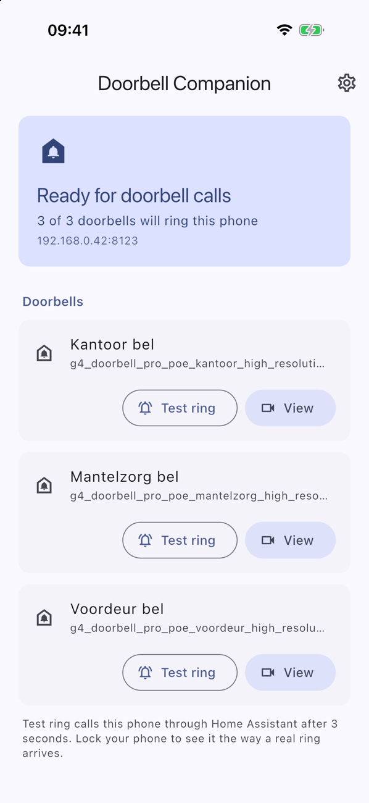
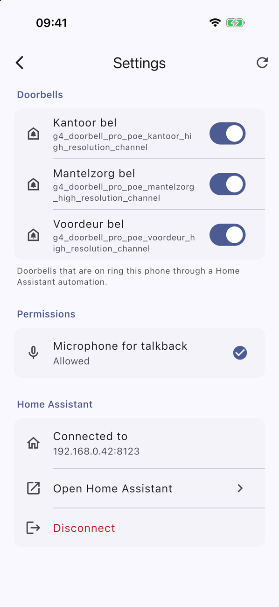
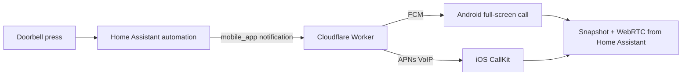

<p align="center"></p>

<h1 align="center">Doorbell Companion</h1>

<p align="center">Doorbell rings become phone calls with live video, for Home Assistant on Android and iOS.</p>

<p align="center">
  
  &nbsp;
  
  &nbsp;
  
</p>

When someone rings, your phone shows an incoming call: a full-screen call on Android, the native CallKit screen on iOS. The camera starts connecting while it rings, so video is live by the time you answer. Works with any Home Assistant doorbell, including UniFi Protect.

## Features

- **One-tap setup.** Finds Home Assistant on your Wi-Fi, signs in through the browser, and creates the ring automation for you.
- **Fast video.** Shows a snapshot right away and switches to WebRTC as soon as the first frame arrives. Local and remote addresses are tried in parallel.
- **Talkback.** Hear visitors, and talk back when the camera supports two-way audio.
- **Multiple doorbells.** Turn each one on or off in Settings.

## How it works



## Requirements

- Home Assistant with WebRTC (go2rtc), a `camera.*` doorbell, and a doorbell `binary_sensor.*` or `event.*`. Calls away from home need your external Home Assistant URL.
- Android 8.1+ with Google Play Services, or iOS 15+.
- Flutter (Dart `^3.13`) to build.

## Build

**Android**

```sh
cd app
flutter build apk --release --split-per-abi
adb install -r build/app/outputs/flutter-apk/app-arm64-v8a-release.apk
```

**iOS.** Open `app/ios/Runner.xcworkspace`, pick your team, and enable Push Notifications for `nl.niek.doorbellcompanion`. Set `DOORBELL_COMPANION_APNS_ENVIRONMENT` to match your provisioning profile (Debug uses sandbox, Release uses production), then run `flutter run` from `app/`. [Relay setup for iOS](worker/README.md#ios-voip-pushes)

## Setup

1. Open the app on your home Wi-Fi and pick your Home Assistant, or enter its URL.
2. Sign in. The app finds your doorbells and creates the automation.
3. Allow notifications, and on Android full-screen calls. Allow the microphone for talkback.
4. Under a doorbell, tap **View** to check the camera, then **Test ring** and lock your phone within 3 seconds.

Moving from a build with an older app ID? Disconnect that one first to avoid double rings.

## Self-hosting the relay

The app uses a hosted relay by default. To run your own, follow the [Worker setup](worker/README.md) and point the app at it with `PUSH_RELAY_URL` in [HomeAssistantAuth.kt](app/android/app/src/main/kotlin/nl/niek/doorbellcompanion/HomeAssistantAuth.kt) (Android) and `DoorbellCompanionRelayURL` in [Info.plist](app/ios/Runner/Info.plist) (iOS).

## Tips

- **UniFi Protect:** enable the medium-resolution camera entity in Home Assistant and tap refresh in Settings. The app prefers it, which starts video faster on cellular.
- **Timings:** run `adb logcat -s DoorbellTiming:I DoorbellCompanion:I` on Android, or filter the Xcode console for `Doorbell Companion` on iOS.

## License

[MIT](LICENSE)
